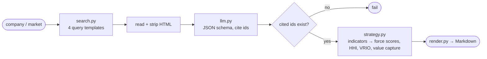

# AI market research agent

**Question:** What is the structure of a given market, measured rather than asserted, with each claim traceable to a source?

**Output:** a Markdown report covering competitors, five forces (qualitative and quantified), key success factors and risks, where every claim cites a numbered source and unsourced fields read "insufficient evidence".

**Why I built this:** to get from a market question to a cited, structured first draft in minutes.



## Run
```
pip install -r requirements.txt
python -m research_agent "French SMB accounting SaaS" --demo      # offline, cached sample
RESEARCH_LLM_API_KEY=... [RESEARCH_LLM_BASE_URL=...] [RESEARCH_LLM_MODEL=...] \
  python -m research_agent "Pennylane" --out report.md            # live, any OpenAI-compatible API
python -m research_agent.strategy_demo                            # strategy engine on cited foundry data
pytest -q
```

## Strategy engine (`research_agent/strategy.py`)
| Function | Method |
|---|---|
| `hhi`, `hhi_band`, `cr` | HHI = Σ sᵢ² (percentage shares), banded with the 2023 DOJ/FTC thresholds (>1,800 highly concentrated, 1,000–1,800 moderately) |
| `score_force` | Each indicator maps to a 1–5 score by explicit cut-offs (`RULES`), and the force score is the mean over sourced indicators |
| `industry_attractiveness` | 6 − mean force score, over forces that have evidence |
| `vrio` | Valuable → Rare → Inimitable → Organized, each test requiring a source, giving one of five competitive implications |
| `value_split` | Value created = WTP − cost; firm captures price − cost; buyer captures WTP − price |

**Worked example:** [`samples/foundry_strategy.md`](samples/foundry_strategy.md)
- HHI is at least 5,051 (top-10 shares, TrendForce 2Q25), so the market is highly concentrated, and CR4 is 87.0%.
- TSMC's 2025 capex/revenue is 33.4%.
- Rivalry and new-entrant threat both score 1/5.
- VRIO comes out as a sustained competitive advantage.
- Buyer power, supplier power and substitutes are reported as insufficient evidence.

**Market report:** [`samples/example_report.md`](samples/example_report.md) covers French SMB accounting and finance SaaS (Pennylane, Qonto, Cegid/Shine) with 7 cited sources.

**Limitations:**
- Demo mode replays a cached, hand-verified sample whatever subject you enter.
- The LLM step is tested with mocks.
- Citations are checked for existence, not for entailment.

See [DESIGN.md](DESIGN.md).
